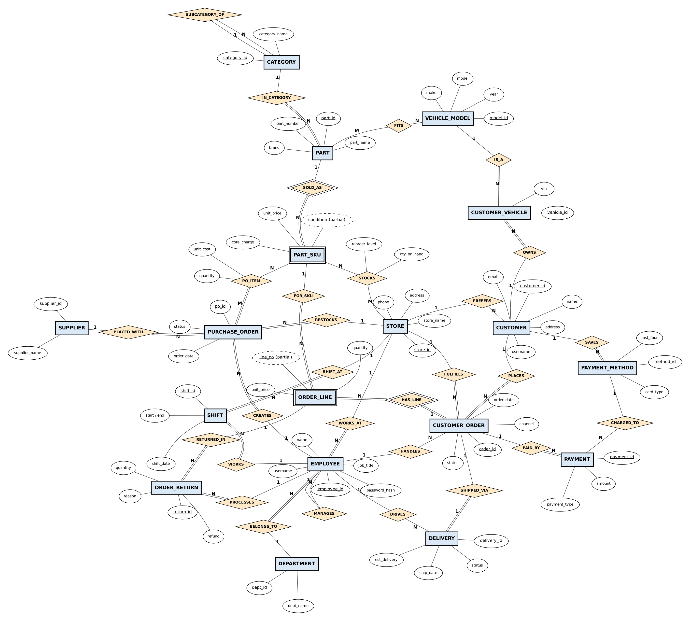
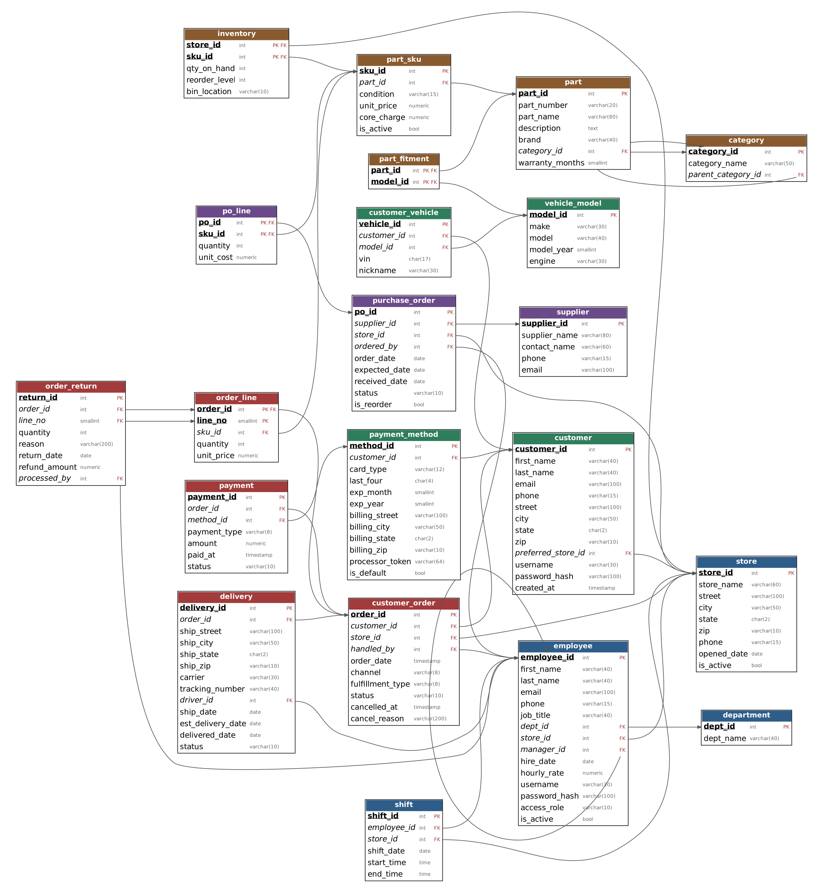

# RoadReady Auto Parts — Retail Database System

A relational database for a small auto parts retailer with two stores and room to expand. It supports a **customer mode** (browse and search parts by vehicle, order online, pay by card, view order history) and a **store mode** (employees, shifts, inventory, supplier reorders, deliveries, returns and reports).

Built for **CSCE 4350 – Fundamentals of Database Systems** at the University of North Texas (Fall 2026).

**Stack:** PostgreSQL 16 · PL/pgSQL · pgcrypto · Graphviz (diagrams) · Node.js / Express / React planned for the application layer

---

## ER diagram



Chen notation: rectangles are entities, diamonds are relationships, double borders mark weak entities (PART_SKU, ORDER_LINE) and their identifying relationships, and double lines mark total participation.

## Schema diagram



## Tables

21 tables, all in BCNF.

| Area | Tables |
| --- | --- |
| Stores & personnel | `store`, `department`, `employee`, `shift` |
| Customers & vehicles | `customer`, `customer_vehicle`, `vehicle_model`, `payment_method` |
| Catalog & inventory | `category`, `part`, `part_fitment`, `part_sku`, `inventory` |
| Purchasing | `supplier`, `purchase_order`, `po_line` |
| Sales & fulfillment | `customer_order`, `order_line`, `payment`, `delivery`, `order_return` |

## Design highlights

- **Multi-store by design.** Stock is tracked per store and SKU in `inventory`, so adding a branch is just a new `store` row.
- **New vs. remanufactured parts.** Each part can be sold as a NEW or REMANUFACTURED `part_sku` with its own price and core charge. Keeping price out of `inventory` removes a BCNF violation, since price depends on part and condition, not on the store.
- **Vehicle fitment search.** `part_fitment` links parts to `vehicle_model`, so customers can find parts that fit their saved car.
- **Integrity in the database.** Primary and foreign keys, `CHECK` constraints on domains, quantities and dates, and two triggers:
  - `trg_return_qty` blocks returning more than was bought on an order line.
  - `trg_receive_po` adds stock to the right store when a purchase order is marked RECEIVED.
- **Security.** Passwords are stored only as bcrypt hashes (`pgcrypto`). Cards are stored only as type, last four digits and a payment-processor token, never the full number.
- **Reports as views.** `v_daily_sales`, `v_inventory_status`, `v_low_stock`, `v_employee_roster` and `v_order_totals` compute totals on demand, so they can't drift out of sync.
- **History is preserved.** Employees are deactivated rather than deleted, and each order line stores the price actually charged.

## Getting started

Requires PostgreSQL 14 or newer (developed on 16).

```bash
createdb roadready
psql -d roadready -f sql/schema.sql
psql -d roadready -f sql/sample_data.sql
```

The schema script creates everything in a `roadready` schema and re-creates it on each run. The sample data covers two stores, 7 employees, 5 customers, 8 parts in 10 SKUs, purchase orders, web and in-store orders, card and cash payments, a cancellation, a delivery and a partial return. Demo accounts use the password `Demo#2026` (stored hashed).

### Example queries

```sql
SET search_path TO roadready;

-- Parts that fit a 2018 Toyota Camry, with price and total stock
SELECT p.part_number, p.part_name, k.condition, k.unit_price, SUM(i.qty_on_hand) AS in_stock
FROM part p
JOIN part_fitment f  USING (part_id)
JOIN vehicle_model v USING (model_id)
JOIN part_sku k      USING (part_id)
JOIN inventory i     USING (sku_id)
WHERE v.make = 'Toyota' AND v.model = 'Camry' AND v.model_year = 2018
GROUP BY 1, 2, 3, 4
ORDER BY 1, 3;

-- Low-stock report
SELECT * FROM v_low_stock;

-- Daily sales by store
SELECT * FROM v_daily_sales ORDER BY sale_date;
```

More query output, including constraint violations being rejected, is in [`docs/screenshots`](docs/screenshots).

## Regenerating the diagrams

Both diagrams are generated with Graphviz. The schema diagram reads the live database catalog, so it always matches the tables.

```bash
cd tools
python3 er_diagram.py && neato -Tpng er.dot -o ../docs/er-diagram.png
PGHOST=localhost python3 schema_diagram.py && dot -Tpng schema.dot -o ../docs/schema-diagram.png
```

## Project status

- [x] Phase I — requirements analysis and conceptual design
- [x] Phase II — ER diagram, relational schema, normalization, PostgreSQL implementation
- [ ] Phase III — Node.js / Express API, React customer and store interfaces, testing and demo

## Team

Gabriel De La Cruz · Jordan Mofa · Adedoyin Omopariola · Michael Okine
